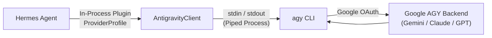

# Antigravity Model Provider Plugin for Hermes Agent

A hardened, native model-provider plugin that connects **Hermes Agent** directly to your **Google Antigravity (`agy`)** subscription without requiring a standalone HTTP proxy daemon.



## Features

- **Native Hermes Integration**: Runs directly inside Hermes as an `external_process` model-provider plugin (`auth_type="external_process"`, `base_url="acp://antigravity"`). Eliminates the standalone HTTP daemon, port 8642 dependency, and network overhead.
- **Full Tool Calling Orchestration**: Dual-protocol parsing supporting both `<tool_call>` tags and `<<<TOOL_CALLS>>>` markers. Multi-turn conversations delegate tool execution to Hermes while AGY provides reasoning and inference.
- **Rigorous Process Lifecycle & Cancellation**: Tracks exact spawned child PIDs. Early stream termination triggers immediate, recursive process-tree termination (`taskkill /F /T /PID` on Windows) leaving zero orphaned child processes while keeping pre-existing parent sessions intact.
- **Active Native Tool Interception**: Continuously monitors the `stream-json` event stream. Any native tool execution attempt by AGY triggers immediate fail-fast process termination, preventing unmanaged host actions.
- **Isolated Temporary Working Directories**: Every inference invocation executes within a dedicated, disposable temporary directory (`hermes_agy_*` under `%TEMP%`), completely unlinked upon turn completion.
- **Permission Boundary Enforcement**: Runs without `--dangerously-skip-permissions`, ensuring AGY cannot bypass authorization checks.
- **Multi-Turn Context Pruning**: Preserves the 8 most recent tool outputs while pruning older diagnostic output (65% head, 35% tail) and annotating failed tools (`[Tool Result: {name} (Failed)]`).
- **Dynamic Model Catalog**: Full catalog discovery with exact context lengths (2M for Gemini Pro, 1M for Gemini Flash, 200k for Claude, 131k for GPT-OSS) and reasoning effort tiers (`low`, `medium`, `high`).

## Installation in Hermes

Link or clone the repository into your Hermes plugins directory:

```bash
# User plugins directory
git clone https://github.com/Anubisx404/agy-proxy.git ~/.hermes/plugins/antigravity
```

Validate with Hermes:

```bash
hermes plugins validate ~/.hermes/plugins/antigravity
```

Enable the plugin:

```bash
hermes plugins enable antigravity
```

## Usage

Select any available AGY model via `/model` or the CLI:

```text
/model antigravity gemini-3.8-flash-low
/model antigravity gemini-3.8-flash-medium
/model antigravity claude-sonnet-5-5-medium
/model antigravity gemini-3.1-pro-high
/model agy flash
```

Or configure as default in `~/.hermes/config.yaml`:

```yaml
model:
  default: gemini-3.8-flash-low
  provider: antigravity
  reasoning_effort: low
```

### CLI One-Shot Usage

```bash
hermes -z "What is the capital of France?" --provider antigravity -m gemini-3.8-flash-low
```

## Security & Isolation Model

| Component | Mechanism | Scope & Boundary |
|---|---|---|
| **Credential Resolution** | `base_url="acp://antigravity"` | Satisfies Hermes provider router locally; no outbound auth requests |
| **Working Directory** | `tempfile.mkdtemp(prefix="hermes_agy_")` | Isolated temporary workspace cleaned up on completion; not an OS sandbox |
| **Permissions** | Removal of `--dangerously-skip-permissions` | Disallows unapproved native execution |
| **Tool Guard** | Active `step_type == "tool"` interception | Terminates `proc` tree immediately if native tool execution is attempted |
| **Process Tree** | `taskkill /F /T /PID` on stream abort | Guarantees child tree teardown on generator cancellation |

## Running Tests

Run the full unit test suite:

```bash
pytest tests/
```

Run the live hardening and cancellation verification suite:

```bash
python tests/verify_cancellation_and_security.py
```

## License

MIT
