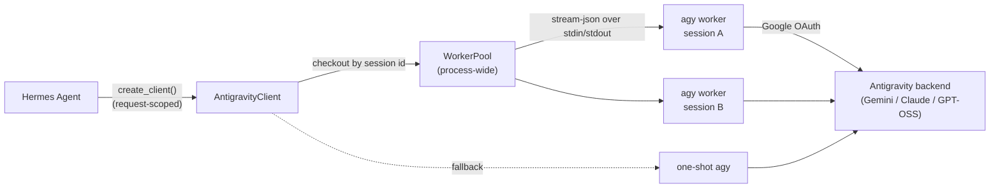

# Antigravity Model Provider Plugin for Hermes Agent

Runs **Hermes Agent** on your **Google Antigravity (`agy`)** subscription. The plugin drives the `agy` CLI
directly (no HTTP proxy) and keeps a **persistent background `agy` worker per Hermes session**, so a
conversation stays in one live agy process across turns and each turn sends only the new messages.



## How the persistent worker works

A worker is one long-lived `agy --input-format stream-json --output-format stream-json` process. Each
turn writes one `{"event": "user", ...}` line to its stdin and reads stream-json events until that
turn's `result`. agy keeps the conversation in memory, so:

1. **First turn of a session**: the worker gets the full prompt (headless preamble, Hermes tool
   schemas, system prompt, transcript).
2. **Every later turn**: only the messages Hermes added since the last turn are sent (tool results and
   the new user message). The model's own previous reply is already in agy's trajectory and is not
   sent again. If Hermes changes the tool set mid-session, the new list is sent as part of the delta.
3. **Session binding**: Hermes builds and closes request-scoped clients freely, so workers live in a
   process-wide pool rather than on a client. The profile passes Hermes' `session_id` through
   `extra_body`, and the pool gives each session its own worker. Requests without a session id
   (auxiliary calls) are matched to a worker by the conversation history it already holds.
4. **History changes**: if the history no longer extends what the worker has seen (compression,
   `/retry`, `/undo`, edits, `/new`), the worker is replaced and the new one gets the full prompt.
5. **Model or effort switch**: a new process resumes the *same* agy conversation with
   `--conversation <id>` under the new model, still sending only the delta.
6. **Idle workers** are stopped after `AGY_WORKER_IDLE_SECONDS` (default 15 min). The session's agy
   conversation id is kept, so the next turn resumes it with `--conversation` and a delta prompt.
   At most `AGY_MAX_WORKERS` (default 4) workers run at once; the least recently used idle one is
   stopped first. All workers are stopped when Hermes exits.
7. **Self-healing**: a worker that died while idle, a resume agy refuses, or an agy without
   `--input-format` support is detected before any output is streamed, and the turn is retried
   transparently (fresh worker, or one-shot mode). An agy that rejects `--effort` gets it dropped.
   A second concurrent request in the same session, or a full pool, runs as a one-shot process.

A failed, cancelled or interrupted turn always discards its worker: a half-finished agy trajectory is
never reused.

## Features

- **Persistent workers** as described above, with per-turn token usage derived from agy's cumulative
  session counters.
- **Real streaming**: text streams as it arrives even when tools are enabled; only a possible
  `<tool_call>` opening is held back. Tool calls stream as OpenAI tool-call deltas. Thinking output is
  forwarded as `reasoning_content`.
- **Tool calling protocol**: Hermes tools are described with their full JSON schemas (affordable because
  a worker receives them once per session). Calls are parsed from `<tool_call>` blocks, the legacy
  `<<<TOOL_CALLS>>>` markers, fenced JSON, unterminated blocks, and bare JSON naming a known tool. Call
  ids are always unique. Text after the first tool call (hallucinated results) is dropped.
- **Native tool interception**: if agy tries to run one of its own tools (`step_type == "tool"`), the
  process tree is killed immediately and the turn fails, so Hermes stays the only executor.
- **Interrupts**: the client implements `cancel()`, which Hermes calls from its interrupt thread for
  non-HTTP providers; the in-flight agy process is killed and the turn ends at once.
- **Timeouts that work**: stdout is read on a background thread, so a silent agy is detected after the
  timeout (Hermes' read timeout, `AGY_TIMEOUT_SECONDS`, default 300s) instead of blocking forever.
  stderr is drained continuously, so a chatty agy can never fill the pipe and stall.
- **Fast quota failover**: agy retries HTTP 429 internally for minutes without output. The plugin
  watches agy's stderr and its own log file for `RESOURCE_EXHAUSTED` / credit exhaustion and fails
  the turn quickly with a classification Hermes can fail over on.
- **Error classification** (`classify_api_error`): quota → `rate_limit`, credits/billing cap →
  `billing`, empty SUCCESS / trajectory limits → `context_overflow` (Hermes compresses), account
  verification / ToS → `auth_permanent`, signed out → `auth`, unknown model → `model_not_found`,
  silence → `timeout`.
- **Model catalog from `agy models`**: grouped per base model with its supported efforts and cached
  for an hour. Hermes' reasoning effort (`/reasoning`, `reasoning_effort:`) is forwarded and mapped to
  the nearest effort the model supports (`xhigh`/`max` → `high`); models agy lists without effort
  variants get no `--effort`. If the account lacks a requested model (e.g. `claude-opus-5-5`), the
  newest model of the same family in the catalog is used.
- **Context window**: declared as min(native window, 239,000 tokens). agy checkpoints its trajectory
  at ~239,616 tokens whatever the model, so Hermes compresses before agy truncates silently.
- **Account quota in `/usage`** via `fetch_account_usage` (`agy -p /usage --output-format json`,
  cached for 60s).
- **Async-safe**: completions are awaitable and streams support `async for` (Hermes' auxiliary path).
- **Honest capabilities**: agy receives prompts as text, so the plugin declares no vision support;
  Hermes then routes images through its vision tool instead of having them silently dropped.

## Installation

```bash
hermes plugins install https://github.com/Anubisx404/agy-plugin
```

or clone it into your Hermes plugins directory:

```bash
git clone https://github.com/Anubisx404/agy-plugin.git ~/.hermes/plugins/antigravity
hermes plugins validate ~/.hermes/plugins/antigravity
```

Requirements: `agy` installed and signed in (run `agy` once in a terminal), and a Hermes Agent with
model-provider plugin support. Profile fields an older Hermes does not know are skipped instead of
failing the plugin load.

## Usage

```text
/model antigravity gemini-3.8-flash
/reasoning high
/model agy pro
```

Effort-suffixed ids from earlier versions (`gemini-3.8-flash-low`) still work; an explicit Hermes
reasoning effort takes precedence over the suffix.

```yaml
# ~/.hermes/config.yaml
model:
  provider: antigravity
  default: gemini-3.8-flash
  reasoning_effort: low
```

```bash
hermes -z "What is the capital of France?" --provider antigravity -m gemini-3.8-flash
```

Aliases: `flash`, `pro`, `sonnet`, `opus`, `gpt-oss`, each optionally followed by `-low`, `-medium`
or `-high`.

## Configuration

| Variable | Default | Effect |
| :--- | :--- | :--- |
| `AGY_CLI_PATH` | `agy` on PATH | Path to the agy binary (`HERMES_AGY_COMMAND`, `ANTIGRAVITY_COMMAND` also work). |
| `AGY_ARGS` | (none) | Extra arguments for every agy process (shell-split). |
| `AGY_MODE` | (none) | Passed as `--mode`. |
| `AGY_WORKER_IDLE_SECONDS` | `900` | Stop a worker after this long without a turn; `0` keeps workers until exit. |
| `AGY_MAX_WORKERS` | `4` | Maximum concurrent persistent workers (each is a full agy process). |
| `AGY_DISABLE_PERSISTENT` | off | `1` runs every turn as a one-shot process (previous behaviour). |
| `AGY_TIMEOUT_SECONDS` | `300` | Silence tolerated from agy when Hermes passes no timeout. |
| `AGY_CONTEXT_LENGTH` | min(native, 239000) | Context window declared to Hermes. |
| `AGY_ENV_PASSTHROUGH` | (none) | Comma-separated variables to pass to agy even if they look like secrets. |
| `AGY_ENV_STRICT` | off | `1` passes only a runtime baseline (PATH, HOME, locale, temp, proxy, certs, keyring, Windows basics) plus `AGY_ENV_ALLOWLIST`. |
| `AGY_PROXY` | (none) | Proxy URL for agy (sets `HTTP(S)_PROXY`/`ALL_PROXY`, keeps loopback direct). |
| `AGY_CONFIG_DIR` | `~/.gemini/antigravity-cli` | Where agy keeps its token and logs (sign-in detection, quota log watch). |
| `AGY_DEBUG_PROMPT_DIR` | (none) | Write every prompt sent to agy to this directory (mode 0600). |

The `ANTIGRAVITY_*` spellings used by the soyelmismo plugin are accepted for the overlapping settings.

## Security model

| Boundary | Mechanism |
| :--- | :--- |
| Tool execution | Hermes executes every tool. agy runs without `--dangerously-skip-permissions`, the prompt redirects tool use to `<tool_call>` text, and any native tool step kills the agy process tree. |
| Working directory | Each worker / one-shot process runs in its own private temp directory (`hermes_agy_*`), removed when the process ends. Project `GEMINI.md` / `AGENTS.md` files are not picked up. |
| Environment | Credential-looking variables (`*TOKEN*`, `*SECRET*`, `*API_KEY*`, `*PASSWORD*`, database/broker URLs, webhooks, DSNs…) are removed before agy starts; strict allow-list mode is available. |
| Process lifetime | Every agy runs in its own process group (POSIX session / Windows process group) and is killed as a tree (`killpg` / `taskkill /T`), including agy's language-server child. Workers stop on idle, on failure, on cancel, and at interpreter exit. |
| Credentials | Only the presence of agy's token file or OS credential entry is checked for setup status; contents are never read. |

## Comparison with soyelmismo/hermes-antigravity-subscription

That project pioneered the persistent stream-json worker for Hermes; several ideas here come from it
(delta prompts, `--conversation` resume, cumulative usage deltas, error classification, credential
scrubbing, `/usage`). Differences in this plugin:

| | This plugin | hermes-antigravity-subscription |
| :--- | :--- | :--- |
| Worker ownership | Process-wide pool keyed by Hermes `session_id`; survives Hermes' request-client churn | One worker per client object; closing or replacing the client ends it |
| Interrupts | `client.cancel()` kills the in-flight turn | No `cancel()` |
| Read timeout | Background reader thread: a silent agy times out | Blocking `readline()`; the deadline is only checked between lines |
| Recovery before output | Broken pipe, refused `--conversation` resume, unsupported `--input-format` or `--effort` retried transparently | Broken pipe on send retried; other cases fail the turn |
| Tool set changes mid-session | Sent in the delta | Not re-sent after the first turn |
| Tool call ids | Always minted unique | Model-written or `acp_call_N`, can repeat across turns |
| Worker state per session | 16-byte digest per message | The full message list |
| Isolated HOME | No: agy uses your normal agy home | Yes, with token symlinks and keychain links |
| Vision | Declared unsupported (Hermes describes images) | Declared supported, image parts are dropped |

## Tests

```bash
pip install -r requirements.txt
python -m pytest tests -v
```

The suite includes end-to-end tests that run a fake `agy` (`tests/fake_agy.py`) speaking the
stream-json protocol, covering worker reuse, delta prompts, resume, model switches, cancellation,
timeouts, quota failover, fallbacks and process cleanup (POSIX only; skipped on Windows).

Against a real, signed-in agy:

```bash
python tests/live_verify.py gemini-3.8-flash-low
```

## License

MIT
